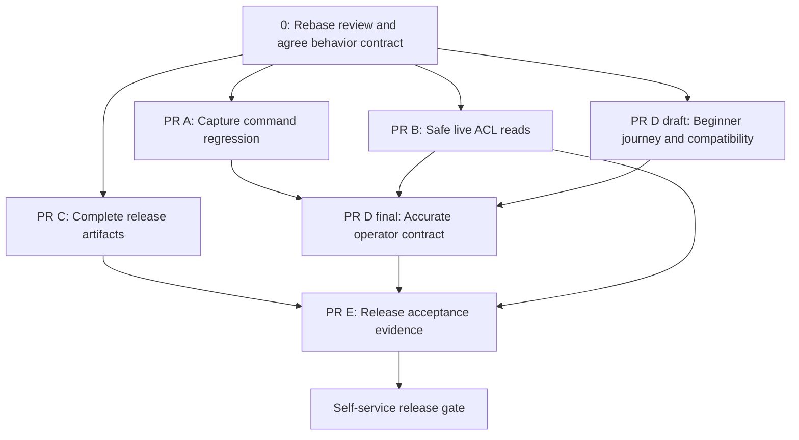

# Public readiness execution plan for Claude

Date: 2026-11-01  
Review baseline: `dea247c`; findings rechecked on `ca9c2e6` (2026-11-02)  
Status: proposed execution plan; implementation has not started

## Objective and release decision

Enable an enthusiastic operator who is not an ACL or Pure Storage expert to download a release, capture an approved directory/file ACL template, apply it to a small tree on their own FlashBlade or FlashArray, and verify the result without maintainer coaching.

The implementation has substantial safeguards and test coverage. The main release gap is the operator journey: executable examples, packaging, prerequisite discovery, accurate safety semantics, and meaningful verification. Fix the release-gating work below before promoting the tool as self-service. Existing public availability does not require taking the repository down; it does require avoiding broader readiness claims until these gates pass.

This plan is stored in this repository under the [maintenance covenant](MAINTAINERS.md), which permits public-safe plans here (see [docs/CLAUDE.md](docs/CLAUDE.md)). Do not copy private local instructions, lab addresses, credentials, or identities into this plan, PRs, tests, or published evidence.

The user requested a plan, not implementation or publication in this turn. A subsequent instruction to execute this plan authorizes implementation within the requested scope; live array mutations and release publication must follow the authorization available in that execution session.

## Evidence and limits of the review

- Reviewed documentation, release packaging, capture/apply/validation code, tests, and committed hardware results at the baseline above.
- Reproduced the documented `build-spec` invocation failing with `--output is required` because flags appear after positional arguments.
- `go test ./...` passed after rerunning outside sandbox restrictions that prevented localhost fake-server sockets and permission-bit tests. This was an offline suite, not live hardware verification or a race run.
- No repository files were changed during the review. No GitHub settings, published asset contents, or organization permissions were audited.
- The live-read hazard below is a code-path concern supported by the repository's recorded array observations. It was not newly reproduced on hardware. Do not present it as a universal array defect or a confirmed firmware boundary.
- Recheck the current branch before editing: intervening changes may already address parts of this plan. Preserve unrelated changes.
- Recheck on `ca9c2e6`: the only change since the baseline is the maintenance covenant (docs/policy). R1 (capture reads both exemplar ACLs before it emits notes; `--validate` runs its preflight only when the spec has a `sacl:` key), R4 (README and INSTALL put flags after the paths; a current-source build fails with `--output is required`) and R5 (`RELEASE_DOCS` is README, LICENSE, INSTALL only) still reproduce. Every local link in this plan resolves. R2, R3, R6 and R7 were not rechecked.

## Priorities and traceability

P1 means a safety or operational-contract issue. P2 means an onboarding or distribution issue. Both can gate a usable public release; P2 does not mean optional.

| ID | Finding | Priority | Delivery |
|---|---|---|---|
| R1 | Capture reads live exemplars before proving reads are safe; DACL-only validation also needs audit | P1 | PR B |
| R2 | Quick start applies a permissive demonstration policy to a production-looking path | P1 | PR D |
| R3 | Published audit semantics disagree with current preservation code | P1 | PR B contract, PR D documentation |
| R4 | Documented capture commands fail due to flag ordering | P2, release gate | PR A and PR D |
| R5 | Release archive omits examples/docs required by its own README | P2, release gate | PR C |
| R6 | Validation is described as proof of intent; inheritance effects need explicit explanation | P1 for onboarding | PR D and PR E |
| R7 | Compatibility claims conflict with recorded results and tool-specific platform support | P2, release gate | PR D |

## Parallelism, ownership, and dependencies

Use one integration lead and at most three concurrent implementation agents initially. Separate worktrees/branches are preferred. Do not have agents edit the same README, Makefile, CI workflow, or core safety file concurrently. Parallelism should separate ownership, not split individual functions between agents.

The lead owns the behavior contract, cross-workstream decisions, final documentation integration, and release-gate checklist. Specialists return a concise handoff containing changed files, tested behavior, exact checks, unresolved questions, and dependencies.

| Workstream | Initial owner | Exclusive edit area during first wave | Independent work |
|---|---|---|---|
| Capture command correctness | Agent A | Capture CLI tests and a narrow parser change only if justified | Reproduce/document invocation contract; regression tests |
| Live-read safety | Agent B | `internal/run`, `internal/apply`, `internal/speccapture`, session/GUI safety plumbing as needed | Call-path inventory, threat scenarios, safety contract, fakes |
| Release packaging | Agent C | `Makefile`, release smoke-check script, release workflow | Package inventory, archive checks, Windows capture artifact discovery |
| Beginner documentation | Lead initially; dedicated writer after contract freeze | README, INSTALL, COMPATIBILITY, operator docs, public contributor instructions | Outline and evidence inventory can begin immediately |

Agent A must coordinate with B before changing `cmd/build_spec/main.go`; prefer a documentation correction over a parser redesign. Agent C owns release/CI edits until merged. The docs owner should collect requested wording from others and apply it once rather than accepting competing README changes.



PR C can be developed before PR D, but its final archive-content checks must include the new guide delivered by D. PR E harness design can begin early; its final execution must use the integrated candidate. Hardware cases sharing a filesystem, export configuration, identity configuration, or snapshot state must run serially unless the lab owner provides isolated resources.

## Phase 0 — Establish the contract before changing behavior

1. Record current HEAD and status; read applicable repository instructions.
2. Reproduce R4 on current source, not an old binary in the working directory.
3. Trace capture, apply, compare, dry-run, validate, GUI capture/verification, partitioned runs, and shared sweep paths. Inventory every path that reads an existing object's ACL.
4. Record which operations create disposable probes and which ones read or write existing objects. Distinguish local output files from array mutations.
5. Establish one behavior table for the release candidate. Use the following as the baseline to verify, not an instruction to change behavior silently:

| Spec / invocation | Baseline behavior to confirm |
|---|---|
| `acl:` without `sacl:`, without `--sacl` | Replace DACL; preserve each object's existing audit/alarm entries visible over NFS; apply proves audit bypass first |
| `acl:` without `sacl:`, with `--sacl` | Refused |
| `acl:` plus `sacl:`, with `--sacl` | Replace both specified components |
| `sacl:` without `acl:`, with `--sacl` | Keep each object's DACL entries subject to identity/fidelity guards; replace SACL; apply requires flattening acknowledgment |
| Any `sacl:` key without `--sacl` | Refused |
| `sacl: []` in an otherwise valid invocation | Explicit removal of auditing |
| Capture with no visible audit ACEs | Emit DACL spec |
| Capture with audit ACEs, default options | Emit SACL-only rules; does not copy template DACL |
| Capture with audit ACEs and `--with-dacl` | Emit both components; can replace destination auditing as well |
| `--validate` | Compare applicable stored permission components with spec; does not prove effective access or policy intent; SACL validation currently writes a disposable probe |

6. Do not describe preserved NFS ACE bytes as proof of identical raw SMB descriptors, inheritance state, owner/group, or effective access.
7. Decide the supported beginner scenarios explicitly. A scenario may be withheld from the beginner guide pending evidence rather than given an unsupported promise.

Relevant code: [run](internal/run/run.go), [apply](internal/apply/apply.go), [capture](internal/speccapture/capture.go), [capture CLI](cmd/build_spec/main.go), [sessions](internal/session/session.go), [verification summaries](internal/summary/verification.go).

## PR A — Make documented template capture executable

Suggested title: `Fix template capture command examples and regression coverage`

### Work

- Reproduce the README/INSTALL command with flags after paths. The baseline parser uses Go `flag.FlagSet`; it stops parsing at the first positional argument.
- Prefer the small fix: all documented flags precede the directory and file arguments. Do not introduce a CLI parsing dependency merely to accommodate these examples.
- Add a meaningful regression test using the exact corrected command shape and injected readers/transports. Prove that it reaches capture and emits a valid spec, rather than merely proving the parser accepts a string.
- Cover the Linux shape and the direct-userspace shape used by macOS/Windows capture. Include PowerShell continuation syntax in the documentation review.
- Search README, INSTALL, GUI instructions, shell scripts, and public contributor instructions for the same mistake.
- Correct stdout/stderr documentation: inspect the code before saying where identity reports and YAML are emitted.

Corrected Linux command shape:

```bash
build-spec --output project-permissions.yaml \
  /mnt/fb/templates/folder /mnt/fb/templates/file.txt
```

### Acceptance

- Tests demonstrate that the documented command reaches the intended capture path.
- Every published capture invocation uses the supported ordering.
- No array access is needed for the CLI regression tests.
- All platforms' examples identify the required executable and available artifact.

Sources: [README capture section](README.md#build-spec), [INSTALL](INSTALL.md), [CLI parser](cmd/build_spec/main.go), [CLI tests](cmd/build_spec/build_spec_test.go).

### Bunching guidance

This is a small independently useful PR. The lead may apply its limited README/INSTALL changes before the larger PR D starts, or Agent A may hand the exact wording to the docs owner. Do not leave the live README broken while waiting for the entire documentation rewrite. Keep safety refactoring out of this PR.

## PR B — Close unsafe live-read gaps and define observable behavior

Suggested title: `Guard live ACL reads before capture and validation`

### Problem and evidence

`CaptureWithOptions` reads directory/file ACLs before producing a warning about unprivileged reads on affected FlashArray configurations. The repair path already calls `ProveAuditBypass` before certain live reads because the repository records inherited SACL loss from such a read. `runValidate` currently runs its preflight only when the spec names a SACL key. This deserves an explicit review for DACL-only validation too.

Read [capture](internal/speccapture/capture.go), [run preflight and validation](internal/run/run.go), [probe implementation](internal/apply/apply.go), [recorded boundary uncertainty](benchmarks/sacl-item7-20261016/RESULTS.md), and [RISKS](RISKS.md). Do not assume a universal firmware cutoff from a historical message in the source.

### Required design decisions

1. Identify affected read entry points, including CLI and GUI capture, capture verification, DACL-only validation, SACL validation, compare/apply, and shared orchestration.
2. Select a common enforcement layer without introducing dependency cycles or pulling repair/walk packages into the Windows capture executable. Preserve the existing Windows dependency guard.
3. A guard must establish safety before any existing exemplar/root/descendant ACL read. A warning after the read is insufficient. A probe that reads an inherited ACL before establishing safety also needs scrutiny, even if that probe is disposable.
4. Resolve the read-only contract explicitly. Do not silently make ordinary capture perform array writes. If a scratch probe is required, expose the requirement and fail with an actionable explanation when it has not been authorized/configured. An explicit restriction is preferable to an unsafe fallback.
5. Do not claim the existing `--verify-write` solves this automatically: at baseline it occurs after capture. Reorder or redesign only with a clear contract and tests.
6. Do not reuse an apply preflight indiscriminately for validation: it may write a spec or require privileges beyond the particular safety proof. Define exactly what needs proving and why.
7. Keep POSIX-only operations out of unnecessary NFS audit checks. Preserve fail-closed behavior for unsupported or uncertain NFS scenarios.
8. Define proof lifetime and scope: a proof must be tied to the relevant server/export/credential/session, not treated as global across connections or targets.

### Implementation and tests

- Add fake-transport call-order tests showing no live ACL read happens before the required proof.
- Denied, unsupported, timed-out, or failed proof must stop before existing-object reads/writes.
- Test proof cleanup on success and error; surface cleanup failures.
- Test invisible auditing: an empty returned SACL is not evidence that the identity can observe auditing safely.
- Cover CLI and shared GUI session paths, both transports where supported, and DACL-only versus SACL validation.
- Check dry-run behavior explicitly; do not introduce probe writes into a mode advertised as non-mutating.
- Test preservation/refusal for audited descendants under an unaudited root, unreadable ACLs, and unpreservable identities using existing fixtures where possible.
- Maintain the distinction between byte preservation in the NFS view and SMB descriptor fidelity.
- Remove unconfirmed version-boundary statements from runtime messages.

### Acceptance

- The agreed safety contract holds in call-order tests for every supported entry point.
- No hidden fallback reads existing ACLs after a failed safety check.
- Capture and validate help/error messages accurately disclose probe behavior and prerequisites.
- Windows capture dependency/build checks remain green.
- A qualified lab owner verifies affected cases using isolated fixtures and records firmware, controller state when relevant, identity, transport, and observed descriptor state. If live verification is unavailable, explicitly hold the affected support claim rather than mark it verified.

### Bunching guidance

Keep this a dedicated safety PR with focused tests and a short contract note. If a prerequisite abstraction is large, split it into a behavior-preserving refactor followed by the safety fix. Do not hide the safety change inside a documentation or packaging PR. Coordinate disclosure through [SECURITY.md](SECURITY.md) if the maintainers classify the confirmed gap as a vulnerability; do not post sensitive reproduction details publicly by default.

## PR C — Ship a complete, discoverable operator package

Suggested title: `Ship the beginner guide and examples with release archives`

### Work

- Inspect [Makefile](Makefile) and [release workflow](.github/workflows/release.yml). At baseline `RELEASE_DOCS` includes README, LICENSE, INSTALL, but not the examples/docs referenced by the quick start.
- Include the beginner guide from PR D, required example specs, compatibility information, and linked operational prerequisites. Either ship each required local document or use an explicit version-appropriate online link. Avoid broken relative links.
- Keep private instructions, lab-only material, development binaries, and secrets out of archives. Do not package the entire checkout indiscriminately.
- Preserve the single top-level archive directory and executable permissions.
- Install/document both `permissionreset` and `build-spec` for the primary path. Distinguish companion tools from the minimal operator install.
- Determine the actual Windows capture delivery path. The Makefile has a separate cross-build target and embeds a Windows executable in the SACL helper directory; do not assume the release workflow publishes a standalone Windows ZIP. Publish/document a clear supported capture artifact or explicitly explain availability.
- Provide a direct release-page link and precise platform selection. Placeholder URLs alone are not a beginner installation flow.
- Provide checksum instructions that work on the documented OS; do not require a Linux-only checksum utility on stock macOS without explanation.

### Archive acceptance check

Add a focused smoke-check script run against the staged/extracted release, not the source tree:

1. Enumerate expected artifacts and documents.
2. Extract into a fresh temporary directory away from the source checkout.
3. Run native binaries with `--version` and `--help`; do not execute foreign-platform binaries on the host.
4. Confirm referenced beginner specs exist and load successfully without requiring an array.
5. Confirm local links in the shipped beginner path resolve; allow explicitly external links.
6. Confirm Windows capture packaging matches its installation instructions.
7. Confirm archive contents do not depend on ignored local files.

Use an isolated worktree for `make release`, which invokes `clean`; do not remove another agent's binaries. Do not publish a tag/release just to test packaging.

### Acceptance and bunching

Packaging changes, archive tests, and their workflow integration belong together. This PR may precede PR D structurally, but cannot be declared complete until the final guide is included and tested. Defer unrelated provenance/signing or release-publisher rewrites.

## PR D — One beginner journey and an accurate support contract

Suggested title: `Document a safe template-to-tree repair workflow`

Proposed new guide: `docs/field-preview/getting-started.md`. This path is proposed, not an existing link.

### Primary journey

Write one complete route first: Linux, kernel NFSv4.1 transport, an explicitly supported array configuration, and a small disposable pilot tree. Add FlashBlade userspace/macOS and FlashArray differences in short decision branches. Do not force a novice to assemble a workflow from performance, SACL, and benchmark chapters.

The guide must cover:

1. **Choose the operation.** Explain DACL/access versus SACL/auditing and what the tool replaces. Capture with audit ACEs currently defaults to SACL-only output: surface this before capture, not after an unsuccessful repair.
2. **Choose the supported route.** Array, firmware evidence, client OS, kernel/userspace transport, authentication, and required executable. Distinguish Windows capture from Windows repair support.
3. **Collect prerequisites.** Server/export or mounted path, intended target, authorized identity, audit bypass where the final contract requires it, directory-service mappings, and a quiet change window. Explain which values come from the storage/identity administrator.
4. **Prepare recovery.** Take and verify a restorable snapshot before target changes. Explain restore scope and potential loss of unrelated post-snapshot data changes; do not imply snapshot presence freezes the live namespace. Separate FlashBlade and FlashArray instructions. Verify product-specific commands against authoritative versioned documentation before publishing them.
5. **Prepare two approved exemplars.** One directory and one regular file; keep them outside the repair target. Explain why both are needed and how an operator checks their intended access first.
6. **Capture and inspect.** Give working commands. Explain generated `acl:` versus `sacl:` fields, `OWNER@`/`GROUP@`, named/numeric identities, owner/group behavior, and audit intent. Do not prescribe `--with-dacl` blindly: it can also copy the template's auditing. If the desired combination is DACL replacement with destination auditing preserved, explain how to obtain/review the correct spec under the final contract.
7. **Preview.** State precisely what dry run proves and what it cannot prove: privilege to write, effective access, complete enumeration of inaccessible data, and intended policy are separate concerns.
8. **Canary apply.** Use a disposable representative tree with known object counts, existing exceptions, and expected allowed/denied users. Put any mutating commands after the recovery and scope explanation.
9. **Verify.** Structural validate plus ordinary-user allowed/denied access, file creation, child inheritance, and SMB checks if applicable. Do not test effective access only as root/admin.
10. **Run at scale.** Show checkpoint/log/summary paths outside the target, explicit target and exclusions, stop/resume behavior, and how to detect incomplete coverage. Keep tuning optional.
11. **Recover or escalate.** Explain snapshot-based recovery limits, partial runs, exit codes, diagnostic collection, and safe sharing of logs.

### Reconcile existing material

- Replace the README's production-looking generic `--apply` quick start with a short pointer into the complete journey and a safe capture/canary sequence.
- Mark [the generic ACL example](examples/nfsv4_basic.yaml) as demonstration-only and explain its broad read grants. Do not silently change its policy and call that sufficient onboarding remediation.
- Synchronize the Phase 0 behavior table across [README](README.md), [spec guide](docs/spec-guide.md), its [HTML counterpart](docs/spec-guide.html), [troubleshooting](docs/field-preview/troubleshooting.md), [SACL runbook](docs/field-preview/sacl-runbook.md), and CLI/runtime messages.
- Find how the HTML guide is maintained; regenerate if there is an established generator, otherwise update it consistently and record the method.
- Correct [runbook](docs/field-preview/runbook.md) language that equates zero mismatches with intended access. Explain structural agreement versus effective access, inheritance, and audit-event delivery.
- Promote explicit/protected DACL effects into the main template workflow. The [FlashBlade results](benchmarks/dacl-reset-fidelity-20261020/RESULTS-fb.md) record protected DACLs without inherited ACE markers after reset; do not bury this only in SACL guidance.
- Reconcile [COMPATIBILITY](COMPATIBILITY.md) with [FlashArray DACL-reset results](benchmarks/dacl-reset-fidelity-20261020/RESULTS-fa.md). Historical evidence supports only its tested version/configuration; it does not automatically certify the current candidate.
- Build the compatibility matrix by operation × array × client OS × transport. Label compilation, offline testing, historical hardware evidence, and current hardware verification separately.
- Correct stale platform/binary counts and CI statements in INSTALL and public contributor instructions. Do not change private local instructions or copy them into tracked material.
- Correct [SECURITY](SECURITY.md) terminology: `--compare` with `--apply` can write mismatches, and SACL validation can write a disposable probe. Keep the security-reporting policy coherent with advertised behavior.
- Keep performance/transport reference detail in the existing linked documents, consistent with [docs conventions](docs/CLAUDE.md).

### Acceptance

- A reader has a complete path from download to verified canary, with no prerequisite hidden behind an advanced SACL section.
- Each documented command uses real supported flags/order and explicit placeholders explained nearby.
- No statement promises read-only array behavior where disposable writes occur.
- No preservation statement conflates NFS bytes with SMB descriptor fidelity.
- No historical hardware result is presented as current-candidate verification.
- All referenced local paths and anchors in the changed operator journey resolve.

### Bunching guidance

Keep README, INSTALL, compatibility, and beginner-guide changes together so the front door and detailed instructions agree at merge. If too large, split into a contract-correction PR and a beginner-guide PR, with the latter depending on the former. Assign one docs integrator to both. Do not combine this with a new capture-intent CLI feature.

## PR E — Verify the integrated candidate and record release evidence

Suggested title: `Add self-service release acceptance checks and evidence`

### Offline checks

- Run focused tests for each code change during development.
- Run the repository's required CI checks once on the integrated candidate, including its race tests and supported-platform build checks. Do not claim success from cached tests against a different commit.
- Run the archive smoke checks from PR C against the final packaging/guide.
- Check relative links and executable examples in the changed documentation.
- Run the existing public-content scan when its inputs are available. If it cannot run locally, record that limit and use the existing CI gate; do not copy private scan inputs into the repository.

### Lab acceptance matrix

Use isolated fixtures through the established authorized lab process. Do not perform mutations on user production data. Avoid new broad performance benchmarks; correctness and operator usability are the release gates.

| Scenario | Required result |
|---|---|
| Approved directory/file templates, ordinary DACL reset | Generated spec applies and structurally validates; intended allow/deny checks pass |
| Unaudited root with audited descendant | Existing descendant auditing is preserved under the documented preservation mode |
| Capture/validation without required read-safety privilege | Safe refusal before existing-object ACL read; actionable message |
| Template contains audit ACEs | Capture output and resulting operation match the documented intent; user cannot mistake SACL-only capture for DACL capture |
| Unmapped/synthetic-range identity | Correct refusal or explicitly supported behavior; no silent identity substitution |
| SMB-written data | Raw descriptor checks and ordinary-user access checks agree with the documented fidelity limits |
| New child after repair | Inheritance behavior matches the guide; protected/explicit state is understood |
| Interrupted apply and resume | No false completion; coverage and counts reconcile with a fresh validation pass |
| Snapshot recovery on disposable fixture | Pre-repair state can be recovered; scope and data-loss implications are documented |
| Each advertised beginner platform/array route | Download and guide are sufficient; unsupported routes are labeled clearly |

Promote/reuse raw-descriptor verification from [existing differential evidence](benchmarks/dacl-reset-fidelity-20261020/README.md) where appropriate, but make the operator procedure runnable without private lab paths or hard-coded identities. NFS validation, SMB descriptor inspection, effective-access tests, and delivered audit events are different evidence dimensions.

### External-reader trial

Ask one operator who did not implement the tool to use only the release archive and beginner guide. Observe without coaching. They must:

- Select the correct binary/transport and explain the operation's scope.
- Capture approved exemplars and explain which ACL components will change.
- Complete the canary and detect an intentionally inappropriate permission using access tests.
- Interrupt/resume and recognize an incomplete or failed run.
- Explain and demonstrate recovery on the disposable fixture.

Record every point where maintainer intervention was needed and fix the guide or product before closing the gate. This is not replaced by unit tests.

### Evidence and completion

Record candidate commit/version, artifact checksums, client/array/firmware/transport, credential category without secrets, fixture definition, checks performed, pass/fail/unverified status, and remaining exclusions. Keep sensitive raw lab data private; publish sanitized summaries through established repository conventions.

PR E may contain acceptance scripts, reusable checklists, and sanitized evidence. If no code/doc artifact is needed for a particular human test, record it in the release checklist instead of manufacturing a PR. Publish/tag only under the execution session's release authorization.

## Future-release backlog — create issues after release-gating scope is stable

Do not let these delay the core release unless acceptance exposes a concrete dependency.

| Suggested issue | Scope and acceptance | Dependency |
|---|---|---|
| Make capture intent explicit | Separate copying access permissions from copying auditing; specify backward compatibility and CLI/GUI parity; remove audit-content-dependent surprise | Stable safety contract |
| Add readable policy review | Explain grants, replacement of exceptions, owner/group and inheritance effects; never claim effective-access simulation without proving it | Accurate spec semantics |
| Expand documentation CI | General command/link checks beyond the critical beginner path; keep offline tests deterministic | Initial smoke checks |
| Improve release provenance | Pin mutable CI tools/actions appropriately, assess signing/attestations, document verification | Working release package |
| Make release publication resumable | Handle partial asset upload failure and reruns without an apparently complete release missing assets | Packaging inventory |
| Expand hardware certification | Additional firmware, architectures, macOS direct transport, identity configurations, SMB inheritance cases | Repeatable acceptance harness |
| Consolidate historical evidence | Link historical investigations from stable support docs without making operators read chronological lab narratives | Documentation reconciliation |
| Guided template workflow | Consider wizard/GUI assistance only after the command-line journey works unaided | External-reader trial |

For each issue, include the user problem, concrete acceptance criteria, affected files, evidence links, exclusions, and dependencies. Do not publish an unverified safety concern as a confirmed vulnerability or file duplicate issues without checking existing work.

## Merge and release checklist for the integration lead

- [ ] Current source and review findings reconciled; superseded findings recorded.
- [ ] Behavior contract settled before final operator wording.
- [ ] PR A merged or its exact command fixes integrated into PR D.
- [ ] PR B reviewed independently; supported live-read cases verified or explicitly withheld.
- [ ] PR C archives complete and smoke-tested away from the checkout.
- [ ] PR D beginner journey, semantics, compatibility, and platform instructions agree.
- [ ] PR E checks run against the exact candidate; limits recorded honestly.
- [ ] External-reader trial completed without maintainer coaching.
- [ ] Snapshot recovery and ordinary-user allow/deny tests verified on disposable fixtures.
- [ ] Public artifact scan and required CI gates passed, or explicit blockers remain open.
- [ ] Remaining improvements captured as issues with no release blockers mislabeled as follow-ups.
- [ ] Release notes name observable behavior changes, prerequisites, limitations, and upgrade effects.

Do not mark this plan complete merely because the documentation is polished or tests pass. Completion means the advertised beginner routes work with the shipped artifacts and the safety/verification claims are supported by evidence.
